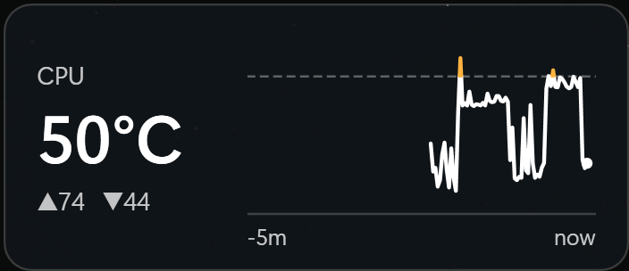

# CPU Temperature Widget

[](https://github.com/eddygk/cpu-temp-widget/actions/workflows/ci.yml)

A small desktop widget for Windows that shows your **AMD Ryzen CPU temperature** and a **live graph of the last
5 minutes**. It floats on your desktop, you can drag it anywhere, and it turns amber and red when the CPU gets hot.



- **Big number** = temperature right now, coloured white (below 70 °C), amber (70-85 °C) or red (85 °C and up).
- **▲ / ▼** = the highest and lowest reading in the last 5 minutes.
- **Graph** = the last 5 minutes, newest on the right. Dashed lines mark 70 °C and 85 °C. The line is coloured
  the same way as the number.
- Right-click it for *Always on top*, *Refresh rate* (every 1, 2 or 5 seconds) and *Exit*.
- If the temperature can't be read it shows `--` (hover over it to see why) instead of a number that might be out of
  date.

## What you need

| | |
|---|---|
| **Windows** | Windows 10 or 11, 64-bit |
| **Processor** | An **AMD Ryzen** (or Ryzen Threadripper) processor. It does **not** work on Intel. |
| **AMD's free SDK** | *AMD Ryzen Master Monitoring SDK*, a free download from AMD (step 1 below) |
| **Administrator rights** | The widget asks for them: AMD's SDK loads a small system driver to read the sensor |
| **Microsoft Visual C++ runtime** | Almost every PC already has it. Setup checks and tells you if it's missing |

You do **not** need to install .NET or anything else; the installer includes what the widget itself needs.

## Install

### Step 1: get AMD's free SDK (one time)

The widget reads the temperature through AMD's own SDK. AMD requires everyone to accept its licence personally, so
the SDK can't be bundled here. It takes about two minutes:

1. Open [AMD Ryzen Master Monitoring SDK](https://www.amd.com/en/developer/ryzen-master-monitoring-sdk.html).
2. Follow the download link (it goes to the *AMD Technical Information Portal*) and download the file.
   It is a `.zip` of about 90 MB.
3. Unzip it and run **`AMDRyzenMasterMonitoringSDK.exe`**. Accept the defaults. No restart is needed.

(This widget was built and tested with SDK version 3.1.1.5478.)

### Step 2: install the widget

1. Download **`CpuTempWidget-Setup-<version>.exe`** from the
   [latest release](https://github.com/eddygk/cpu-temp-widget/releases/latest).
2. Run it. Windows may show a blue **"Windows protected your PC"** screen, because this free hobby project isn't
   code-signed (certificates cost money). Click **More info**, then **Run anyway**.
   If you'd like to check the download first, the release page lists its SHA-256 fingerprint
   (in PowerShell: `Get-FileHash .\CpuTempWidget-Setup-<version>.exe`), and all the source code is in this repository.
3. Click through the wizard. Leave **"Start the widget automatically when I sign in to Windows"** ticked if you want
   it always there.
4. Finish. The widget appears in the top-right corner of your screen.

The two steps work in either order. If you install the widget first, it shows `--` until the SDK is installed, and
then starts working by itself within a few seconds.

## Uninstall

*Settings → Apps → Installed apps → CPU Temperature Widget → Uninstall.* This also removes the sign-in entry.

Left behind on purpose: your settings and a small log in `%APPDATA%\CpuTempWidget` (delete that folder if you like).
AMD's SDK is separate: remove *AMD Ryzen Master Monitoring SDK* from the same Apps list if you don't want it.

## If something looks wrong

Hover over the `--` to see the reason. The usual ones:

| Message | What to do |
|---|---|
| *AMD Ryzen Master Monitoring SDK not found* | Install AMD's SDK (step 1 above). |
| *Platform.dll failed to load (win32 126)* | The Microsoft Visual C++ runtime is missing. Install the [x64 runtime](https://aka.ms/vs/17/release/vc_redist.x64.exe), then restart the widget. |
| *AMD driver unavailable* | The widget needs administrator rights (it asks for them). Security software can also block the driver: check it isn't quarantining `AMDRyzenMasterDriver.sys`. |
| *AMD SDK not responding* | The SDK stopped answering. Right-click → *Exit* and start the widget again. If it keeps happening, please [open an issue](https://github.com/eddygk/cpu-temp-widget/issues) with the log. |

Other things:

- **Widget is off-screen** (for example after changing monitors): close it and delete
  `%APPDATA%\CpuTempWidget\settings.json`.
- **Use one monitoring tool at a time.** AMD warns that several programs reading the same CPU sensors can disturb
  each other's readings.
- **Log file:** `%APPDATA%\CpuTempWidget\widget.log` (start/stop, errors, and a heartbeat once a minute). Attach it to
  a bug report.

## Privacy and security

- The widget **never uses the network** and sends nothing anywhere. It reads the CPU temperature and saves its
  position, refresh rate and a small log on your PC.
- It runs **as administrator** because AMD's SDK loads a kernel driver. The optional sign-in entry is a scheduled
  task set to "run with highest privileges", so you aren't asked for permission every time you sign in.
- The installer is **not code-signed**, hence the Windows warning in step 2.
- It contains no AMD files. AMD's SDK comes straight from AMD.

## Supported hardware

Any AMD Ryzen or Ryzen Threadripper processor that AMD's SDK supports. I developed and tested it on a desktop Ryzen
system running Windows 11; other models should work but are untested. If it works (or doesn't) for you, an issue
with your CPU model is very welcome.

---

## For developers

### How it works

```
WPF overlay (C#, .NET 10, MVVM)  ──P/Invoke──▶  RmTemp.dll (C++)  ──▶  AMD SDK (Platform.dll → driver)
```

The AMD SDK exposes C++ interfaces, which C# can't call directly, so `native/RmTemp.dll` wraps them in four plain C
functions. The sequence follows AMD's own sample: read the install path from the registry, make sure the driver is
running, load `Platform.dll`, `GetPlatform().Init()`, get the CPU device, then `ICPUEx::GetCPUParameters()` →
`dTemperature`. AMD's rule: call it **at most once per second** (enforced in both the app and the DLL).

Why AMD's SDK: motherboard-vendor utilities generally don't offer a public developer API; AMD's SDK is public,
documented and read-only.

### Build from source

You need:

- the **.NET 10 SDK**
- **Visual Studio 2022 Build Tools** with "Desktop development with C++" (for `native/`)
- the **AMD Ryzen Master Monitoring SDK**, installed (the native build uses its headers; they are not in this repo)
- **[Inno Setup 6](https://jrsoftware.org/isinfo.php)** (only to build the installer): `winget install JRSoftware.InnoSetup`

```powershell
# run from an elevated PowerShell
dotnet test tests\CpuTempWidget.Tests -p:Platform=x64      # 37 unit tests, no hardware needed
.\scripts\Build-Installer.ps1 -Version 1.0.0               # native DLL + tests + self-contained publish + installer
.\scripts\Install-CpuTempWidget.ps1                        # or: developer install to %LOCALAPPDATA% + sign-in task
```

### Layout

- `native\`: `RmTemp.cpp/.vcxproj`, the C ABI wrapper (MSVC v143, x64, static CRT). The SDK location comes from AMD's
  registry key (override with `/p:AmdSdkDir=...\`).
- `app\`: the WPF app (the manifest requires administrator).
  - `Models\`: `TemperatureHistory` (5-minute window), `TemperatureBands` (70/85 °C thresholds and frozen brushes),
    `BandSplitter` (splits a line where it crosses a threshold so each part is drawn in its colour).
  - `Services\`: `RyzenMasterTemperatureSource` (all SDK calls on one dedicated thread, with a timeout),
    `DedicatedThreadCaller`, `JsonSettingsStore`, `DiagnosticLog`.
  - `ViewModels\MainViewModel.cs`: state and commands (CommunityToolkit.Mvvm).
  - `Controls\TemperatureChart.cs`: the graph, a `FrameworkElement` that draws in `OnRender`.
- `tests\CpuTempWidget.Tests`: xUnit.
- `installer\CpuTempWidget.iss`: the Inno Setup script (checks CPU vendor, C++ runtime and the AMD SDK; optional
  sign-in task; Start-menu entry; uninstaller).
- `scripts\`: `Build-Installer.ps1`, `Install-CpuTempWidget.ps1`, `Register-StartupTask.ps1`.
- `tools\New-AppIcon.ps1`: generates `app\Assets\app.ico`.

### WPF practices applied ([Microsoft Learn](https://learn.microsoft.com/dotnet/desktop/wpf/))

| Practice | Where |
|---|---|
| MVVM with the .NET Community Toolkit: [overview](https://learn.microsoft.com/dotnet/communitytoolkit/mvvm/), [data binding and MVVM](https://learn.microsoft.com/windows/apps/develop/data-binding/data-binding-and-mvvm) | `MainViewModel`; only `ObservableObject` and the source generators are used (no DI container or messenger) |
| `INotifyPropertyChanged` is the preferred change notification: [Optimizing Performance: Data Binding](https://learn.microsoft.com/dotnet/desktop/wpf/advanced/optimizing-performance-data-binding) | via `ObservableObject`; the UI is all `{Binding}` |
| A custom-rendered control derives from `FrameworkElement`, with dependency properties flagged `AffectsRender`: [control authoring](https://learn.microsoft.com/dotnet/desktop/wpf/controls/control-authoring-overview), [custom dependency properties](https://learn.microsoft.com/dotnet/desktop/wpf/properties/custom-dependency-properties) | `TemperatureChart` (`Samples`, `Span`) |
| `StreamGeometry` instead of many shapes or `PathGeometry`: [Optimizing 2D graphics](https://learn.microsoft.com/dotnet/desktop/wpf/advanced/optimizing-performance-2d-graphics-and-imaging) | one geometry per colour band, rebuilt once per reading |
| Freeze brushes, pens and geometries: [Freezable overview](https://learn.microsoft.com/dotnet/desktop/wpf/advanced/freezable-objects-overview) | all static pens/brushes are frozen; each geometry is frozen after it is built |
| One UI thread; blocking work off it, results back via the Dispatcher: [Threading model](https://learn.microsoft.com/dotnet/desktop/wpf/advanced/threading-model) | the SDK read runs on a worker, then `await` resumes on the UI context |

### Diagnostics: the SDK call can hang

Observed once, during an all-core load test: a native `GetCPUParameters` call never returned. The UI stayed
responsive but polling had stopped, and the window kept showing the last value as if it were live. A stack dump
(`dotnet-stack report -p <pid>`) showed the worker thread stuck in native code inside `RyzenMasterTemperatureSource.Read()`;
no exception was involved. The cause is **unknown**: it did not recur in the next two loaded runs, and nothing else had
AMD's DLLs loaded. So the widget now contains it:

- All SDK calls run on **one dedicated thread named `AMD SDK reader`** (`DedicatedThreadCaller`), as in AMD's own
  single-threaded sample. A read that takes longer than 5 s is reported as a failure (`--`, *AMD SDK not
  responding*); further reads are skipped, not stacked, until the stuck call returns.
- An unexpected exception in a poll tick is logged and shown as `--`; the polling loop keeps running.
- `widget.log` records state changes (errors, "stuck", "returned again after N s") and a heartbeat every minute.

To see where a stuck process waits: `dotnet tool install dotnet-stack --tool-path <dir>`, then
`<dir>\dotnet-stack report -p <pid>` (elevated).

### Gotchas

- AMD's sample loads `Platform.dll` with `LOAD_LIBRARY_SEARCH_DLL_LOAD_DIR` only. That works there because the sample
  already has the shared C++ runtime loaded. `RmTemp.dll` links the runtime statically, so it must also pass
  `LOAD_LIBRARY_SEARCH_SYSTEM32`, or `Platform.dll`'s own imports (VCRUNTIME140, MSVCP140) fail with Win32 error 126.
- SDK 3.1 removed `ICPUEx::GetCurrentTemperature()` and the `AMDRMSDKPATH` environment variable of 3.0: the
  temperature comes from `GetCPUParameters` and the install path from the registry.
- Taking screenshots of a scaled-DPI display from a script: call `SetProcessDPIAware()` first, otherwise you capture
  a cropped corner.

## License

[MIT](LICENSE). This applies to the code in this repository only.

This project is not affiliated with, endorsed by or sponsored by AMD. "AMD" and "Ryzen" are trademarks of
Advanced Micro Devices, Inc. The AMD Ryzen Master Monitoring SDK is not part of this repository; it is licensed by AMD
under its own terms and you download it from AMD.
